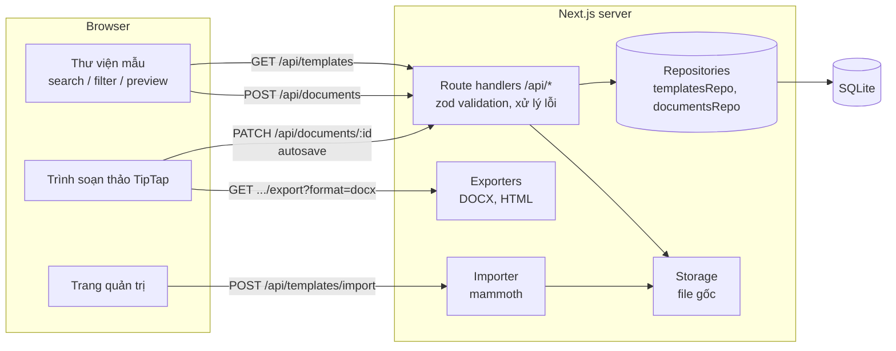

# Office Template Library — Sản phẩm 1: Thư viện mẫu văn bản

Ứng dụng web cho phép **tìm kiếm, xem trước, chọn mẫu văn bản và tạo tài liệu mới** để chỉnh sửa
ngay trên trình duyệt, sau đó **lưu và tải xuống DOCX/HTML**. Tài liệu tạo ra là **bản sao độc lập** —
template gốc (nội dung và file gốc) không bao giờ bị thay đổi.

> Sản phẩm 2 (Thư viện mẫu trình chiếu, PPTX) nằm ở repo `presentation-template-library`, chạy cổng 3001, dùng chung kiến trúc này (trường `kind` = `presentation`).

---

## 1. Chạy thử nhanh

Yêu cầu: **Node.js ≥ 22.13** (dùng driver SQLite tích hợp `node:sqlite`) và **pnpm** (`corepack enable`).
Không cần Docker, không cần tài khoản cloud.

```bash
pnpm install
pnpm dev            # http://localhost:3000
```

Lần chạy đầu tiên, database `data/app.db` được tạo và **tự động seed 6 template**.
Muốn làm lại từ đầu: xoá thư mục `data/`.

| Lệnh | Mô tả |
|---|---|
| `pnpm dev` | Chạy môi trường phát triển |
| `pnpm build && pnpm start` | Build và chạy production |
| `pnpm test` | Unit + API tests (Vitest, 28 test) |
| `pnpm test:e2e` | E2E test bằng trình duyệt thật (Playwright; lần đầu chạy `pnpm exec playwright install chromium`) |
| `pnpm typecheck` | Kiểm tra TypeScript |

Biến môi trường: xem [`.env.example`](.env.example). Trang quản trị `/admin/templates` dùng mã
`dev-admin-token` ở môi trường dev nếu chưa đặt `ADMIN_TOKEN`.

### Các trang chính

| Đường dẫn | Chức năng |
|---|---|
| `/templates/documents` | Thư viện: lưới/danh sách, tìm kiếm, lọc danh mục, sắp xếp, xem trước |
| `/templates/documents/[id]` | Trang xem trước riêng của một mẫu (link chia sẻ được) |
| `/documents/[id]` | Trình soạn thảo tài liệu (tạo từ mẫu) |
| `/my-files` | Tài liệu của tôi: mở, đổi tên, tải xuống, xoá |
| `/admin/templates` | Quản trị: thêm mẫu (tải lên .docx hoặc JSON), ẩn/hiện mẫu |

---

## 2. Công nghệ

| Lớp | Công nghệ | Lý do |
|---|---|---|
| Frontend | Next.js 16 (App Router), React 19, TypeScript, Tailwind CSS 4, shadcn/ui (Base UI) | SSR + client components, một codebase |
| Trình soạn thảo | TipTap 3 (ProseMirror) | Rich-text, mô hình dữ liệu JSON có schema |
| Backend | Next.js Route Handlers (REST API) | Cùng repo, triển khai đơn giản |
| Cơ sở dữ liệu | SQLite qua `node:sqlite` (tích hợp sẵn trong Node) | Người đánh giá chạy được ngay, không cần cài đặt |
| Lưu trữ file | File system (`data/storage`), gói trong `lib/storage.ts` | Dễ thay bằng S3 / Vercel Blob |
| Xuất DOCX | `docx` | Sinh file Office Open XML thật |
| Nhập DOCX | `mammoth` | .docx → HTML ngữ nghĩa |
| Validation | `zod` | Kiểm tra mọi input API và schema nội dung |
| Kiểm thử | Vitest, Playwright | Unit/API + E2E |

---

## 3. Kiến trúc



### Cấu trúc thư mục

```
app/                     # Pages + API route handlers
  api/templates/...      # list, detail, file gốc, categories, import, create/update
  api/documents/...      # create-from-template, get, patch, delete, export
  templates/documents/   # thư viện + trang xem trước
  documents/[id]/        # trình soạn thảo
  my-files/, admin/templates/
components/              # UI: template-library, preview dialog, editor, toolbar...
lib/
  content/               # mô hình nội dung, HTML renderer an toàn, deep clone
  exporters/docx.ts      # TipTap JSON -> .docx
  importers/docx.ts      # .docx -> HTML
  repositories/          # toàn bộ truy vấn SQL nằm ở đây
  seed/                  # dữ liệu mẫu (6 template)
  db.ts, storage.ts, api.ts, schemas.ts, template-files.ts
tests/                   # Vitest (unit + API)
e2e/                     # Playwright
```

### Quyết định thiết kế chính

1. **Một mô hình nội dung chuẩn (canonical JSON).** Mỗi template lưu nội dung dạng TipTap/ProseMirror JSON.
   Mọi cách hiển thị đều đọc từ JSON này: thumbnail, xem trước, trình soạn thảo, xuất HTML, xuất DOCX.
   → Thumbnail luôn khớp nội dung thật, **thêm mẫu mới không cần ảnh hay sửa giao diện**.
2. **Template chỉ đọc, tài liệu là bản sao.** `POST /api/documents` đọc template rồi `structuredClone`
   nội dung vào một dòng mới trong bảng `documents` (kèm `templateId`, `templateVersion` để truy vết).
   Mọi chỉnh sửa chỉ ghi vào `documents`. Không API nào của người dùng ghi vào `templates`.
3. **File gốc bất biến.** Template tải lên từ .docx giữ nguyên file gốc (byte-for-byte). Template seed/JSON
   được render ra .docx **một lần** khi tải lần đầu rồi lưu lại, nên các lần tải sau trả về cùng một file.
   Khi admin cập nhật nội dung, `version` tăng và phiên bản mới có file gốc mới; tài liệu đã tạo vẫn giữ bản sao cũ.
4. **Mở rộng cho loại tài liệu khác.** Bảng, API và giao diện thư viện đều có trường `kind`
   (`document` | `presentation`). Thêm loại mới (trình chiếu, bảng tính) = thêm schema nội dung + renderer + exporter,
   không phải viết lại thư viện.
5. **Repository pattern.** Route handler không viết SQL; đổi SQLite sang PostgreSQL chỉ cần viết lại 2 file trong `lib/repositories`.

---

## 4. Mô hình dữ liệu

```sql
templates (
  id            TEXT PRIMARY KEY,        -- UUID
  slug          TEXT UNIQUE,             -- định danh dễ đọc
  kind          TEXT,                    -- 'document' | 'presentation'
  name, description, category TEXT,
  tags          TEXT,                    -- JSON array
  thumbnail_url TEXT NULL,               -- tuỳ chọn; mặc định sinh từ nội dung
  file_path     TEXT NULL,               -- khoá storage của file gốc (.docx)
  content       TEXT,                    -- TipTap JSON (nội dung chuẩn)
  search_text   TEXT,                    -- văn bản không dấu để tìm kiếm
  version       INTEGER,                 -- tăng khi nội dung thay đổi
  is_published  INTEGER,
  created_at, updated_at TEXT
)

documents (
  id               TEXT PRIMARY KEY,     -- UUID
  kind             TEXT,
  template_id      TEXT REFERENCES templates(id) ON DELETE SET NULL,
  template_version INTEGER,              -- phiên bản mẫu tại thời điểm tạo
  title            TEXT,
  content          TEXT,                 -- bản sao độc lập
  created_at, updated_at TEXT
)
```

Nội dung (`content`) chỉ chấp nhận các node: `doc, paragraph, heading, text, bulletList, orderedList,
listItem, blockquote, horizontalRule, hardBreak, table, tableRow, tableHeader, tableCell` và các mark:
`bold, italic, underline, strike, code, link` (xem `lib/schemas.ts`).

Chi tiết API: **[docs/API.md](docs/API.md)**.

---

## 5. Định dạng DOCX được giữ nguyên

| Định dạng | Xuất DOCX | Nhập DOCX (admin) |
|---|---|---|
| Tiêu đề H1–H3 | ✅ (style Heading 1–3) | ✅ |
| Đậm / nghiêng / gạch chân / gạch ngang | ✅ | ✅ |
| Căn trái / giữa / phải / đều | ✅ | ❌ (mammoth không đọc căn lề) |
| Danh sách dấu chấm, đánh số, lồng nhau | ✅ | ✅ |
| Bảng, hàng tiêu đề, gộp ô | ✅ | ✅ |
| Liên kết | ✅ | ✅ |
| Khổ A4, lề theo NĐ 30/2020, Times New Roman 13pt | ✅ | — |

Đã kiểm tra: test tự động đọc lại file DOCX xuất ra (round-trip qua mammoth và kiểm tra `word/document.xml`),
và mở thủ công bằng LibreOffice / Microsoft Word.

---

## 6. Xử lý lỗi, bảo mật và kiểm thử

**Xử lý lỗi**
- API trả lỗi thống nhất: `{ "error": { "code", "message", "details?" } }` với mã HTTP phù hợp
  (400 dữ liệu sai / ID sai định dạng, 401, 404, 409 trùng slug, 413 quá lớn, 500 không lộ stack trace).
- Giao diện: skeleton khi tải, thông báo lỗi kèm nút "Thử lại", trạng thái rỗng "Không tìm thấy mẫu phù hợp",
  trang 404 thân thiện, toast khi lưu/tạo thất bại, cảnh báo khi rời trang còn thay đổi chưa lưu.

**Bảo mật**
- Mọi input được validate bằng zod; nội dung chỉ nhận các node/mark trong whitelist.
- HTML hiển thị được sinh từ JSON bằng renderer tự viết: escape toàn bộ text, chỉ xuất thuộc tính trong whitelist,
  chặn link `javascript:` (có test XSS).
- File .docx tải lên: giới hạn 5MB, kiểm tra magic bytes; HTML từ mammoth được parse lại qua schema của trình soạn thảo
  nên mọi thẻ lạ (script, style…) bị loại bỏ.
- Giới hạn body 1MB, ID phải là UUID, tên file tải xuống được làm sạch, khoá storage do server sinh (chống path traversal).
- API quản trị yêu cầu header `x-admin-token` (so sánh constant-time).

**Kiểm thử**
- `tests/content.test.ts`: deep clone, seed hợp lệ, renderer HTML + XSS, tìm kiếm không dấu.
- `tests/docx.test.ts`: xuất DOCX (heading, căn lề, đậm/nghiêng/gạch chân, bảng, danh sách), round-trip, nhập DOCX.
- `tests/api.test.ts`: tìm kiếm/lọc/phân trang, 400/404/409/413, **tạo tài liệu không làm thay đổi template và file gốc**,
  cập nhật template tăng version nhưng tài liệu cũ giữ nguyên, ẩn mẫu, quyền admin.
- `e2e/document-flow.spec.ts`: tìm kiếm → xem trước → dùng mẫu → chỉnh sửa → tự lưu → tải lại trang → tải DOCX;
  lọc danh mục, trạng thái rỗng, trang 404.

---

## 7. Thư viện bên thứ ba và giấy phép

| Thư viện | Giấy phép |
|---|---|
| next, react, react-dom | MIT |
| tailwindcss, tw-animate-css, class-variance-authority, clsx, tailwind-merge | MIT |
| shadcn/ui, @base-ui/react | MIT |
| lucide-react | ISC |
| @tiptap/* (core, react, starter-kit, extension-table, extension-text-align, pm) | MIT |
| docx | MIT |
| mammoth | BSD-2-Clause |
| zod | MIT |
| sonner | MIT |
| @vercel/analytics | MPL-2.0 |
| vitest, jszip (dev) | MIT / MIT hoặc GPLv3 (dùng theo MIT) |
| @playwright/test (dev) | Apache-2.0 |

### Công cụ AI hỗ trợ
- **v0 (Vercel)**: dựng giao diện ban đầu (bố cục thư viện, thẻ mẫu, header).
- **Claude (Anthropic)**: hỗ trợ lập kế hoạch, viết code backend/trình soạn thảo/kiểm thử và tài liệu.
  Toàn bộ code đã được chạy, kiểm thử và rà soát lại.

---

## 8. Đã hoàn thành / Chưa hoàn thành / Giới hạn

### ✅ Đã hoàn thành (Sản phẩm 1)
- Thư viện dạng lưới và danh sách, thumbnail sinh tự động từ nội dung, tên, mô tả, danh mục, thẻ, phiên bản.
- Tìm kiếm không dấu (debounce, ưu tiên khớp tên), lọc danh mục có số lượng, sắp xếp theo tiếng Việt; trạng thái lưu trên URL.
- Xem trước dạng hộp thoại và trang riêng; tải file gốc .docx.
- Tạo tài liệu mới từ mẫu (bản sao độc lập, truy vết phiên bản mẫu).
- Trình soạn thảo: heading, đậm/nghiêng/gạch chân/gạch ngang, danh sách, trích dẫn, căn lề, bảng (thêm/xoá hàng, cột),
  hoàn tác; tự lưu, Ctrl/Cmd+S, cảnh báo rời trang.
- Tải xuống DOCX và HTML; "Tài liệu của tôi" (đổi tên, tải, xoá).
- Quản trị: thêm mẫu bằng file .docx hoặc JSON, xem trước trước khi lưu, ẩn/hiện mẫu; mẫu mới xuất hiện ngay.
- 6 mẫu dữ liệu thử nghiệm (công văn, hợp đồng lao động, biên bản họp, đơn nghỉ phép, báo cáo tuần, thư mời).
- 28 unit/API test + 2 E2E test.

### ⏳ Chưa hoàn thành
- Trang quản trị chưa có form sửa metadata/nội dung mẫu (API `PUT /api/templates/:id` đã có).
- Xuất PDF trực tiếp (hiện tại: tải HTML rồi in ra PDF từ trình duyệt).

### ⚠️ Giới hạn kỹ thuật
- Nhập .docx chỉ giữ định dạng phổ biến: **không** giữ căn lề, màu chữ, font, header/footer, hình ảnh,
  text box, section break, track changes. File gốc vẫn được lưu nguyên vẹn để tải về.
- Trình soạn thảo chưa hỗ trợ hình ảnh, màu chữ, cỡ chữ, header/footer và ngắt trang.
- Một người dùng, chưa có đăng nhập; quản trị dùng một mã tĩnh.
- SQLite + file system phù hợp demo/một máy chủ. Trên Vercel dữ liệu nằm ở `/tmp` (không bền vững).
- File .docx tải lên nhưng không lưu thành mẫu chưa được dọn dẹp tự động.

### 🔭 Hướng mở rộng
- Tích hợp ONLYOFFICE Document Server / Collabora Online (WOPI) để chỉnh sửa DOCX/PPTX với độ trung thực cao —
  bảng `documents` + storage hiện tại đã phù hợp mô hình "file + metadata" của các giải pháp này.
- PostgreSQL (thay repositories), S3/Vercel Blob (thay `lib/storage.ts`), xác thực người dùng + tài liệu theo user.
- Thêm loại `spreadsheet`; quản lý phiên bản mẫu trên giao diện; tìm kiếm full-text (FTS5 / pg_trgm).
